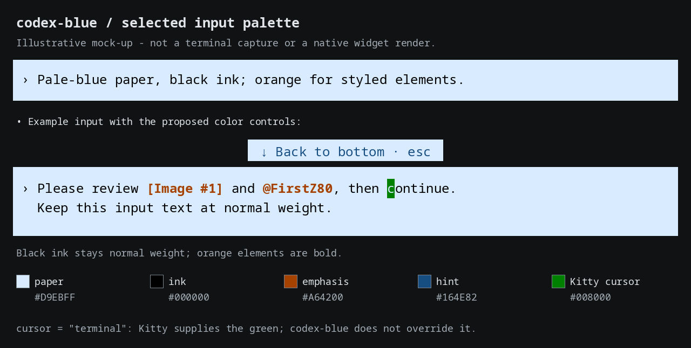

= codex-blue: local CLI user-message colors
:title: {docname}

*Unofficial customization of https://github.com/openai/codex[OpenAI Codex CLI].* This independently maintained project is not affiliated with or endorsed by OpenAI. It publishes a small user-message color patch, local build/reapply scripts and a documented experiment; it does not publish the downloaded upstream checkout or compiled executables.

Licensed under link:LICENSE[Apache-2.0]. Upstream attribution is preserved in link:NOTICE[NOTICE] and link:UPSTREAM-NOTICE[UPSTREAM-NOTICE]. See link:MODIFICATIONS.adoc[the modification notice] for exactly what changed. The recorded absolute paths and screenshots describe Falken's tested local installation; they are not prerequisites for another user's home directory.

_Illustrative mock-up of the selected colors, not a terminal capture._

Built, checked and installed as `/home/falken/.local/bin/codex-blue`. Official Codex CLI 0.166.0, source commit `6ff1e1ca3b30fc8b914720681fcf5fe62e95f856`, isolated Rust 1.95.0. The current profile-schema-2 release adds configurable emphasis, hint and cursor colors plus optional bold user text. Nineteen distinct focused Rust checks and four Python profile checks passed. New frontend visual review remains pending; the ordinary `codex` and the first blue release remain available.

Current local colors: lighter-blue user-message paper `#D9EBFF`, black ink `#000000`, orange emphasis `#A64200` and dark-blue hint ink `#164E82`, adjustable in the explicit `codex-blue` wrapper. Falken confirmed the revised profile after restarting on 2026-11-10. The original build and previews used `#A4CDFB` / `#101820`. See link:docs/261110-1700-REVIEW-input-panel-colors.adoc[the input-panel color audit] for coverage and remaining independent styles.

The ignored `.build` directory is a nested Btrfs subvolume for regenerable toolchain, sources and artifacts. The inspected Snapper configuration covers `/`; home is a separate subvolume. No Snapper policy was changed.

Read link:docs/261110-1743-BUILD-custom-input-palette.adoc[the current handover, settings and verification]. The incremental CLI build took 54 seconds. The initial link:docs/261110-1620-BUILD-Codex-blue-paper-local.adoc[build handover] and link:output/terminal-accepted-261110-1631.png[accepted terminal screenshot] remain as historical evidence; the full Codex workspace suite was not run, as agreed.

Run `codex-blue` to start, `codex-blue --blue-info` for identity/profile, or `codex-blue --blue-off` for stock rendering in the custom executable. Colors are editable in `~/.config/codex-blue/colors.json` without recompilation; restart the frontend and resume the chat to apply edits. It supports `emphasis_ink`, `hint_ink`, `cursor`, `cursor_text` and `user_text_bold` in addition to paper and ink. With `cursor: "terminal"`, Kitty controls both cursor colors; Falken selected green and background-colored text beneath it in Kitty settings. The simple rollback is ordinary `codex`.

The link:docs/261110-1706-PLAN-next-input-palette.adoc[palette design plan] and `drafts/` examples preserve the proposal. It is now implemented in the active patch and launcher; the release handover supersedes their earlier uncompiled status.

== Live progress

Run `tools/status --follow` in another terminal. Ctrl+C stops the viewer only. It shows the workflow stages, elapsed time, a rough remaining planning window, recent compiler activity and memory/disk headroom. After the initial viewer restart, its formatter reloads automatically. The time window is a planning estimate, not a compiler-generated percentage or ETA.

The original 718-second dependency-fetch attempt exposed stale internal package versions in the release lockfile. Read link:docs/261110-1352-NOTE-release-lockfile-normalization.adoc[the audited metadata adjustment]. The retried baseline retains external dependency pins and `--locked`. Read link:docs/261110-1338-NOTE-what-the-Codex-build-downloads.adoc[why Chromium-related repositories were downloaded even though the selected CLI target does not compile V8].

== Reapply tooling

`tools/bootstrap --version 0.166.0` provisions the official source and source-declared Rust toolchain into `.build`. `tools/rebuild-blue --version 0.166.0 --check-only` checks strict patch applicability in a clean worktree. The full `tools/rebuild-blue --version VERSION --package` path builds, runs focused tests and packages a checked release. It stops on incompatible patch context or failed checks. Existing installed releases remain intact until a validated replacement is selected.

Raw local compiler logs are retained under `reports/` and ignored by Git; compact result manifests and explanatory notes are tracked. No credentials or conversation history are copied into these artifacts.
